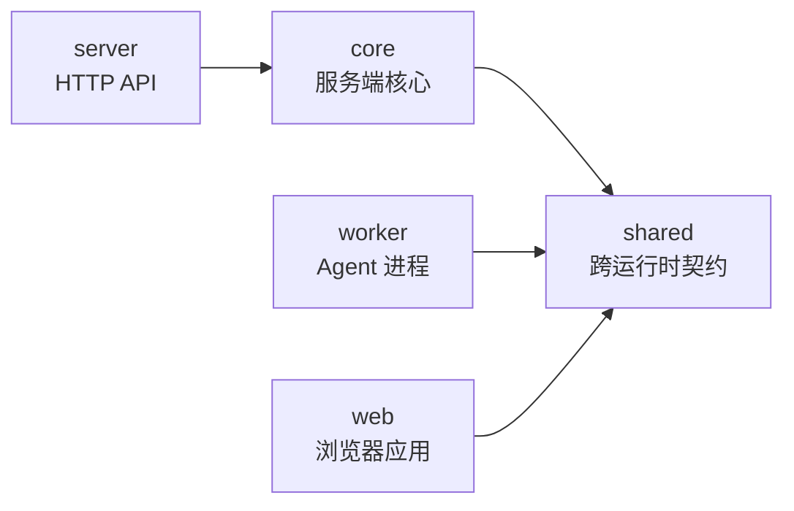
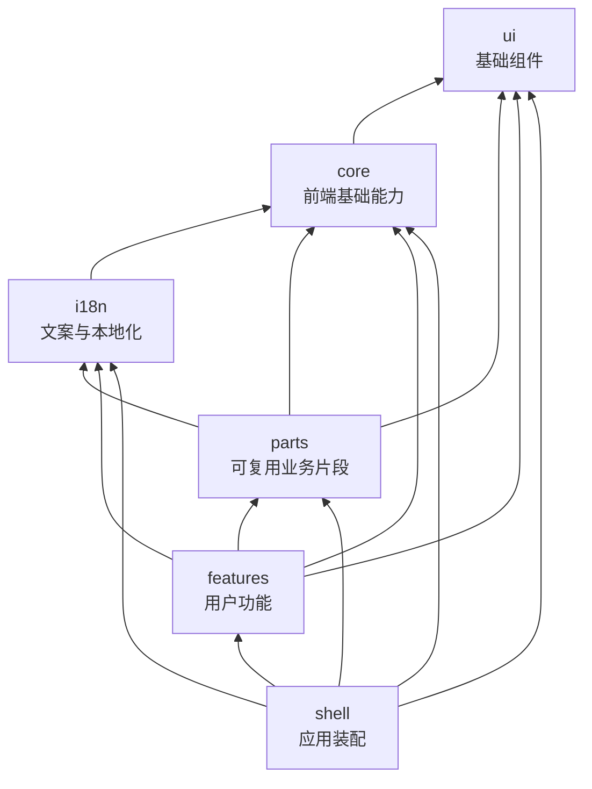

技术栈清单很容易写成一串名词，但真正影响日常开发体验的，通常不是「选了什么」，而是这些技术被放在哪里、谁可以依赖谁，以及新增代码时能不能快速判断它应该落在哪个目录。

这篇文章记录的是我现在用于全栈 Web 项目的一套实际结构。它不是一份通用脚手架，也不是对某个具体产品的介绍；我更关心其中可复用的工程判断：按运行时拆包、让依赖保持单向，再在前端内部建立足够清楚的分层。

## 当前的技术栈快照

整个项目是一个 TypeScript ESM monorepo，由 pnpm workspace 管理。运行时以 Node.js 24 为基准，内部包直接导出 TypeScript 源码，开发阶段由 `tsx` 等工具执行，不额外维护一套只为包间消费服务的 `dist` 目录。

| 范围 | 当前选择 | 主要职责 |
| --- | --- | --- |
| Web UI | React 19、Vite 7、React Router 7 | 单页应用、路由与开发构建 |
| 样式与组件 | Tailwind CSS 4、Radix UI | 样式系统和可访问的基础交互 |
| 客户端状态 | Zustand 5 | 少量跨组件客户端状态 |
| 内容呈现 | React Markdown、KaTeX、Mermaid | Markdown、公式和结构图 |
| HTTP 服务 | Hono 4、Zod 4 | API 路由、输入校验与类型边界 |
| 数据访问 | Prisma 7、PostgreSQL 17 | Schema、迁移与持久化 |
| Agent Worker | Claude Agent SDK、OpenAI Codex SDK | 独立执行进程与模型适配 |
| 工程工具 | pnpm 10、TypeScript 5、Biome 2、Vitest 3 | 工作区、类型、检查和测试 |

这里没有为了「技术栈完整」而补齐每一种常见工具。例如，当前前端没有引入一套额外的服务端状态库；当现有请求模型足以支撑业务时，多一个抽象并不会自动带来更好的边界。技术选择应该跟着真实问题走，而不是跟着清单走。

## 先按运行时拆分顶层包

顶层目录不是按 `controllers`、`services`、`models` 这类横向技术层组织，而是先回答一个更基础的问题：这段代码最终运行在哪里？

```text
idea/
├── packages/
│   └── shared/               # 跨运行时共享的 API 与领域契约
├── web-packages/
│   ├── core/                 # 服务端核心、Prisma、加密与作用域
│   ├── server/               # Hono HTTP API
│   └── worker/               # 独立 Agent Worker 与模型适配器
├── ui-packages/
│   └── web/                  # React 单页应用
├── package.json
├── pnpm-workspace.yaml
└── tsconfig.json
```

`packages/shared` 是所有运行时都可以理解的语言。这里放 API 请求与响应、领域数据结构、枚举和跨进程协议，但不放数据库客户端、Node.js 专属能力，也不放 React 组件。判断标准很直接：浏览器、HTTP 服务和独立 Worker 是否都能安全地导入它？如果答案是否定的，代码就不属于 `shared`。

`web-packages/core` 是服务端核心。Prisma Schema 与 Client、加密、服务端作用域，以及需要直接接触持久化的业务能力放在这里。它可以依赖 `shared` 中的契约，但共享层不反向知道数据库如何实现。

`web-packages/server` 负责把核心能力暴露为 HTTP API。它基于 Hono 组织路由，用 Zod 在网络边界校验输入，再调用 `core`。服务端还会把面向浏览器和面向 Worker 的入口分开组织，这不只是目录整洁：两类调用者的认证方式、权限范围和接口生命周期并不相同，目录本身应该能表达这个安全边界。

`web-packages/worker` 是独立运行的 Agent 进程，内部包含 Claude 与 Codex 的适配器。它通过 HTTP 与 Server 通信，只依赖 `shared` 中的协议，不读取数据库凭证，也不导入 `core`。这样 Worker 可以独立部署和收缩权限；模型 SDK 的变化也不会穿透到服务端核心。

`ui-packages/web` 则是浏览器里的 React 应用。它和 Worker 一样，只通过共享契约理解服务端，不直接依赖数据库实现。前端可以知道一条 API 返回什么，却不应该知道这条数据在 PostgreSQL 里怎样关联。

## 依赖只能朝一个方向流动

目录命名只是提示，真正的边界来自依赖方向。当前最重要的一条规则可以画成下面这张图：



用箭头表示「依赖」，就是 `server → core → shared`，而 `worker → shared`、`web → shared`。运行时通信不等于代码依赖：Worker 会通过 HTTP 调用 Server，但它不需要在包依赖中导入 Server，更不能为了方便直接导入 Core。

这条限制带来几个实际收益。第一，数据库能力只停留在可信服务端；第二，共享协议不会被某个运行时的框架类型污染；第三，替换 UI 构建工具或模型 SDK 时，改动可以被限制在对应包内；第四，看到一次错误导入时，可以立即判断它是在跨越边界，而不是等到部署阶段才发现运行时不兼容。

我倾向于让 `shared` 保持小而稳定。把所有重复出现的类型都移动进去，看起来消除了重复，实际却会把临时页面状态、数据库细节和执行器状态混成一个公共模型。只有确实跨越网络或进程边界、需要由多端共同遵守的定义，才值得成为共享契约。

## 前端目录再按依赖层级展开

顶层先按运行时分开之后，`ui-packages/web/src` 内部还需要解决另一个问题：组件和功能越来越多时，怎样避免任意互相导入？当前结构如下：

```text
ui-packages/web/src/
├── ui/                       # 无业务语义的基础 UI
├── core/                     # 路由、请求、状态等前端基础能力
├── i18n/                     # 文案与本地化入口
├── parts/                    # 可复用的业务片段
├── features/                 # 按用户能力组织的功能模块
├── shell/                    # 应用装配、页面骨架与顶层路由
├── lib/                      # 不依赖 React 的纯工具
└── styles.css
```

这些目录不是同一级的分类盒子，而是一组从基础到装配的依赖层级。

`ui` 位于最底层，放按钮、输入框、弹层等没有业务语义的基础组件，不导入上层目录。`core` 提供路由、请求、状态和前端基础设施，可以使用 `ui`。`i18n` 建立在 `core` 之上，集中管理文案访问方式。`parts` 是能被多个功能复用的业务片段，可以组合 `ui`、`core` 和 `i18n`。`features` 按用户可感知的能力组织，实现具体交互并复用下层。最后，`shell` 负责装配应用，可以看到全部层级，但其他目录不能反向依赖它。



`lib` 稍微特殊：它容纳与 React 无关的纯函数和通用工具。这里的重点不是把所有 `utils` 集中起来，而是保住一个可以在没有组件运行时的环境中独立理解、独立测试的区域。

当新增代码时，我通常按三个问题定位：它是否带业务语义？它是否需要 React？它需要依赖哪些已有层？例如，一个纯粹格式化时间的函数可以进入 `lib`；一个可访问的通用下拉菜单属于 `ui`；一段会读取领域状态但能被多个功能复用的组合界面属于 `parts`；只有完成一项用户任务的完整交互才进入 `features`。这个判断过程比「文件名像不像组件」更可靠。

## 几条配套约定

目录边界需要少量工程约定配合，否则很容易只剩下文档里的箭头。

首先，所有包使用 ESM，并以统一的 TypeScript 配置为基础。模块系统一致，能减少开发、测试和运行时之间的解释差异。其次，内部包直接导出源码。当前仓库里的包是一起开发、一起检查的，没有独立发布需求，因此额外构建每个内部包只会增加监听链路和产物同步成本。

组件通常使用目录承载：组件实现、样式、测试和必要的局部类型放在相邻位置，对外只暴露明确入口。这样移动一个组件时，不需要跨越多个全局目录寻找它的附属文件。同时，包的公开入口保持克制；未从入口导出的模块就仍是实现细节，调用方不能依赖偶然存在的文件路径。

测试也遵循同样的边界意识。重点验证公开接口和跨边界不变量，而不是为每个文件机械创建测试。API 输入校验、权限边界、状态转换这类一旦回归就会产生实际风险的行为优先；简单组合和由 TypeScript、Prisma 或构建器已经保证的结构，不再用脆弱的文本断言重复验证。

## 清楚的结构，也是 AI Coding 的上下文

我现在会让 AI 参与不少实现工作，但没有因此增加一套专门的「AI 架构」。相反，包职责、依赖方向和目录命名越明确，AI 越容易在有限上下文中判断代码该放在哪里，也越不容易为了完成局部任务而穿透边界。

对人和 AI 来说，好的目录结构解决的其实是同一个问题：减少每次修改前需要重新推断的隐含规则。它不会替代代码审查、类型检查和测试，却能让这些质量手段从更清楚的起点开始工作。这也是我记录当前技术栈时，更愿意先画依赖箭头，而不是继续扩充工具清单的原因。

这套结构仍会随着真实需求调整，但调整前必须先说清新的运行时归属和依赖方向。
