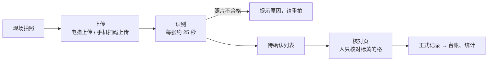
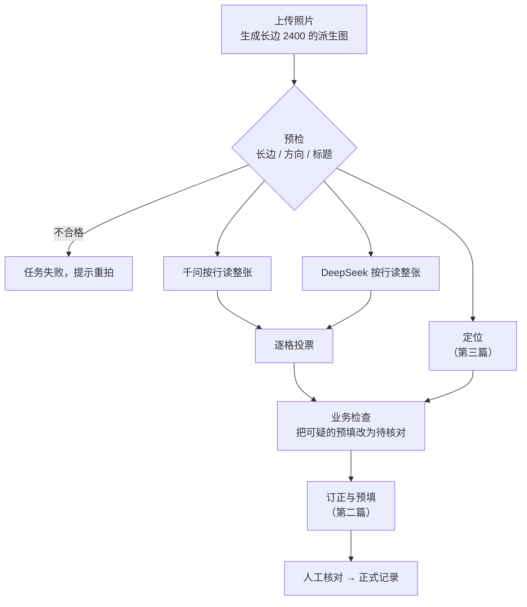

有数是我们给制造业质检做的数据采集应用。工厂现场的报废单、成品检验记录、检具测量表，大多仍是检验员手写的纸质表格。用户拍照上传后，系统把照片识别成结构化记录，由人核对后保存，再进入台账和统计。



*图 1　产品流程。*

识别靠视觉模型。手写的表格里总有一些字迹潦草、可以有几种读法的格，模型难免读错其中一部分。识别会把拿不准的格在核对页上标成黄色，核对的人只看黄格，所以一个格读错了，只要被标黄，就会在核对时改过来。麻烦的是没被标黄的错：没有人会再看它，它会原样进入台账，之后的统计也就不可信了。

所以识别首先要保证的，是读错的格都被标出来；在这个前提下，再去减少人要核对的格。这是三篇文章中的第一篇，讲怎样衡量前一件事，以及我们为此做了什么。第二篇讲后一件事。第三篇讲另一个问题：表格里大部分格为空时，模型常分不清一个数属于哪一格，这时怎样从图像上确定手写内容的位置。

## 静默错误率

识别结果按格（cell）统计。一张报废单有表头几个字段和十几行明细，每行十来列。识别后，每一格要么直接采用识别出的值，不需要人看，下文叫预填；要么在核对页上标黄、附上几个候选，由人确认或修改，下文叫待核对，或者黄格。


*图 2　识别结果示意。照片由程序生成，单据内容与人名均为虚构。*

识别结果的结构和录入表单相同，另外带上待核对的格和两个模型的原始读数。下面是图 2 对应结果的节选。`conflicts` 的键是格的路径，核对页据此标黄；`readings` 不参与显示，留作事后评估和回归测试（见后文「回归」一节）。

```json
{
  "values": {
    "orderDate": "2026-11-07",
    "lines": [
      { "lineNumber": 1, "productName": "1071体L", "issuedQuantity": 120,
        "scrapQuantity": 3, "scrapReason": "砂眼", "operatorName": "李明" }
    ]
  },
  "conflicts": {
    "lines.0.scrapReason": ["砂眼", "沙眼"],
    "lines.2.operatorName": ["王芳", "王方"]
  },
  "readings": [
    { "model": "qwen3.8-flash", "reading": { "header": {}, "lines": [] } },
    { "model": "deepseek-v4.1-flash", "reading": { "header": {}, "lines": [] } }
  ]
}
```

没标黄、识别值却和真值（每一格的正确答案，做法见下一节）不同的格，我们叫它静默错误（silent error），并用它来衡量识别。记参与计分的格（下文叫计分格，范围见下文）的集合为 $C$，其中待核对格的集合为 $P$，格 $c$ 的识别值为 $v(c)$、真值为 $t(c)$：

$$
\text{静默错误率} = \frac{\left|\{\, c \in C \setminus P \;:\; v(c) \ne t(c) \,\}\right|}{|C|}
$$

如果核对的人把黄格都改对了，留在记录里的错就只剩静默错误，所以这个比率可以看作入库数据的错误率。

哪些格算计分格，有三点要说明。第一，有内容的行里的空白格要算：该填却空着、或者本该空着却填了值，都是静默错误；整行空白的行不算，但识别在里面填了值的格计入分子。第二，真值里标为看不清的格不算。第三，检验员和厂商代码两列不算：这两列在纸面上常被拆成几部分分开写，或者写成几段代码，要结合整张单推断。我们允许它们有少量错误，正确率单独统计，下文叫容错列。其余的列，下文叫严格列。

目标分两层，次序不能颠倒：先把静默错误率压到 0.2% 以下，再在这个前提下减少人要核对的格。两者相互制约：多标黄能降低静默错误，但核对的工作量会随之增加。

## 真值

### 做法

要判断静默错误，先得知道每一格的正确答案，也就是真值。到目前为止，我们给 18 张客户的真实报废单照片逐格标注了真值，下文的实验都用这批单据，文中称为真值单。

真值的做法是读两遍再裁决。第一遍把照片分给几个 AI agent 分别读，允许参考模型的识别结果作为草稿；第二遍换另外几个 agent 盲读，只给照片、取值约定（每类格该怎样记，比如空白和看不清怎样区分）和主数据（客户的人员、产品、原因等清单）。两遍逐格对比，不一致的格先按事先定好的规则合并，规则决定不了的，由我们看照片裁决，每条裁决都记下理由。真值由 agent 读出、我们裁决，没有经过人工逐格复核。

两遍的结果大部分一致。不一致的地方，多半不是读法不同，而是取值约定没写清楚，比如空白的格该记成看不清还是空。裁决依据有三类：一是同一产品各行的领用数量之和应当等于责任单位（这一栏印的表头是责任单位，现场实际写的是这一批的总数，各行的领用数量是它的拆分）；二是主数据；三是同一个人在其他单上的写法。

真值记的是纸面的业务含义，不是逐字照抄。一格可以是一个值、空白、看不清（不计分），或者在两种读法都说得通时记成一个列表，任一读法都算对。

裁决时还发现了一件两遍都漏掉的事：有些单据在页脚「现场主管」处写了人名，这些单据的表格下方其实多写了一条记录，那个人名是这条记录的操作工，不是主管的签字。模型也会犯这种错。这处错是对比两遍结果、逐条裁决时才发现的；只读一遍做出的真值，会把错的读法当成正确答案。


*图 3　页脚多写的一条记录。单据内容与人名均为虚构。*

### 0 个错误的含义

在 $N$ 个相互独立的格上没有观察到错误时，错误率 $p$ 的 95% 上限满足 $(1-p)^N = 0.05$，即

$$
p_{95} = 1 - 0.05^{1/N} \approx \frac{3}{N}
$$

18 张单识别一遍，严格列共有 3011 个计分格，上限约为 0.1%。同一张单多识别几遍并不能让 $N$ 变大：后面会看到，同一格在几次识别里常读成同一个错值，这些结果并不独立。所以这 18 张真值最多能说明错误率低于 0.1%。用来检验 0.2% 的目标够了，再往下就需要更多只用于验证的真值。

### 过拟合

我们把 18 张单分成开发集和测试集，各 9 张，所有规则只看开发集来调。即便如此，还是出现过一次过拟合。

检验员一列在纸面上常被拆成几部分分开写，程序要把它们还原成主数据里的人名。为此我们整理过一张写法表，记下某个名字常被写成哪几个偏旁。这张表是从这 18 张单上看出来的，等于拿测试数据调了规则。去掉写法表、只按名字本身的字匹配之后，测试集上检验员一列出现了成片的静默错误。后来加了一条保护：这一列里出现对应不到任何人名的字时，不再把整列都判为同一个人。之后有没有写法表，静默错误都回到 0，代价是黄格多了一些。


*图 4　检验员拆字示意。单据内容与人名均为虚构。*

## 识别流程

我们用的两个视觉模型是千问和 DeepSeek。上传时会生成一张识别用的派生图（见「照片质量」）。每类单据用一份识别配置（recognition spec）声明字段、读图说明和检查规则，平台照着它执行，新增一类单据不需要写任务代码。



*图 5　识别流程。*

| 步骤 | 做法 | 失败时 |
| --- | --- | --- |
| 预检 | 声明了长边门槛的单据，长边不足 2000 像素时拒收；四个方向各问一次「是否正立」；照录印刷标题，由程序判断是不是这类单据 | 任务失败并给出原因；方向判断不出时按原图识别 |
| 读数 | 千问与 DeepSeek 各整张按行读一次，输出按识别配置校验，不通过时把报错发回、重读一次 | 仍不合格的行记为缺失；整份不可用则任务失败 |
| 投票 | 两个模型都有读数且读数相同才预填，其余待核对并列出候选 | — |
| 业务检查 | 纯程序：人名对照主数据、该有却空、日期范围、产品编号与图号一致、领用数量之和等 | 检查出错则任务失败，不把未经检查的预填交给人 |

流程里的分工是：模型只照录看到的字，方向、单据类型以及某一格是否可信，都由程序判断。下面几节说明为什么这样分。

## 两份读数

### 逐格投票

千问用的是 `qwen3.8-flash`，DeepSeek 用的是 `deepseek-v4.1-flash`，都通过阿里云的 OpenAI 兼容接口调用。两家拿到同一张图和同一段提示，各自把整张单读一遍，不开思考模式（thinking）。输出先按识别配置做结构校验：明细行数要等于纸上印的行数，行号从 1 连续编到 N，每行字段齐全。不通过时，把中文报错发回同一段对话，让模型重读一次；仍不通过的行记为缺失。

两份读数先按字段统一写法，只去掉不影响含义的差异，比如图号末尾的省略标记，然后逐格投票：两个模型都有读数、而且读数相同的格直接采用；读数不同或一个模型缺了读数的格标黄，两个读数列为候选；两家都是空白的格保持空白。


*图 6　逐格投票。内容虚构。*

这条规则有一个盲区：两家读成同一个错值时，投票看不出任何问题（图 6 第 ④ 行）。所以投票是否有效，取决于两份读数在同一处犯同一种错的频率。

### 同厂商的两个模型

为了衡量这种同错有多频繁，我们在 18 张真值单上比较了三种组合，投票和业务检查都用线上代码：

| 两份读数 | 次数 | 静默错误（严格列） | 涉及不同的格 | 待核对 / 张 |
| --- | --- | --- | --- | --- |
| 千问 flash 读两次 | 52 | 63 / 8683（0.73%） | 28 | 57.8 |
| 千问 flash × 千问 max | 54 | 24 / 9030（0.27%） | 9 | 52.9 |
| 千问 × DeepSeek | 52 | 10 / 8683（0.12%） | 4 | 73.6 |

*静默错误的分母是几次识别的严格列计分格之和；业务检查用 10 月底时的主数据。这组实验没有运行最后的收尾步骤（第二篇），检验员和厂商代码两列仍算在待核对里；三种组合条件相同，可以互相比较。*

同厂商的两种组合黄格更少，漏掉的错却是跨厂商组合的两到六倍。两份读数分歧少，是因为它们错在同一处：flash 和 max 组合漏掉的格，几乎都和 flash 自己读两遍时漏掉的一样。

表中的数字已经过业务检查，所以这些错都是检查没拦下的。千问读两遍漏掉的格里，大半是把报废原因读成了另一个说得通的原因，比如把「缸孔偏小」读成「加工孔偏小」。报废原因的检查只在读数和主数据里某个原因只差一个字时标黄；读成另一个说得通的原因时，它要么和主数据里某个原因完全一致，要么差了不止一个字，检查都不会标黄。

千问和 DeepSeek 组合漏掉的几个格，在回归一节里逐个解释。

### 换一种读法

我们最早上线的方案用另一种办法凑独立来源：两个模型各按行读一遍、再按列读一遍，四份读数中有三份相同就预填。按列读看起来是一个新来源，但模型看到的仍是同样的笔画。实验结果也说明了这一点：两家按行读都错了的格，按列读绝大多数也错；按行读两家不一致、靠按列读才凑够三票而预填的格，错的比例并不低。

去掉按列读、同时改进交叉检查之后，调用次数减半，静默错误仍为 0，黄格也少了（见下一节的表）。在报废单上，分段读、只读右侧几列、裁图放大我们也试过，都没有收益；裁图拼接后行号对不齐，两家还会在同一处错一行。

## 业务检查

不同厂商的两个模型仍然会读成同一个错值，多发生在字迹有歧义、或者书写习惯特殊的地方。成品检验记录上就有一个例子：检验员习惯把合格记号「○」简写成一小笔「、」。这条习惯写进读图说明之前，两家都把「、」读成空白，读法一致，不会标黄，整张单的合格记号就这样全部漏掉了。写进去之后，千问能读出来，DeepSeek 仍然看不见，两家出现分歧，这些格就被标黄了。


*图 7　合格记号的简写。内容虚构。*

这个例子靠写进读图说明才解决，但不是每种同错都能这样解决，所以投票之后还有一步业务检查。它是纯程序，不调用模型，用业务上的约束找出投票拦不住的错。

检查能做两种事：把预填的格改为待核对，原来的值作为第一个候选；或者在两个独立来源一致时补填一格、撤销一个黄格。后一种放在第二篇讲，这一篇只讲前一种。报废单上的检查有这些：

- 人名不在主数据里，或者主数据里有和它只差一个字的另一个人；
- 写了数量，操作工或处理结果却是空的；
- 日期不在近 60 天内；
- 产品编号不在主数据里，或者和图号对不上；
- 报废原因和主数据里某个原因只差一个字；
- 同一产品各行的领用数量之和不等于责任单位。

下表是几个方案在开发集和测试集上的对照：

| 做法 | 静默错误（开发 / 测试） | 待核对 / 张 |
| --- | --- | --- |
| 4 份读数，3 票预填（最早上线的方案） | 1.6% / 2.2% | 42 / 37 |
| 两家一致才预填 + 人名、该有却空、日期检查 | 0.32% / 0.31% | 54 / 56 |
| 再加交叉检查（数量之和、编号与图号、原因差一字） | 0 / 0 | 67 / 66 |
| 交叉检查改进后，只用两份按行读数 | 0 / 0 | 51 / 50 |

*开发集、测试集各 9 张，每张识别 3 遍。*

从第一行到第三行，检查越多，静默错误越低，黄格也越多。最后一行是现在的方案：交叉检查改进之后，去掉按列读也没有增加静默错误，黄格还回落了一些。

## 照录与判断

方向和单据类型，原本可以直接问模型，但模型在这两件事上的回答不可靠。所以我们让模型只照录，判断交给程序。

### 方向

照片方向不对时，读数会大面积错行，所以识别前要先把图转正。最直接的做法是问模型「需要顺时针转多少度」。它答错的时候，几乎都是把 90° 和 270° 弄反了：模型看得出图是不是正的，却说不准该往哪个方向转。

现在的做法是把图缩小，转出四个方向，每个方向各问一次「印刷文字现在是正立的吗」，恰好只有一个方向回答「是」时才转。


*图 8　方向判断。内容虚构。*

改成这样以后，按上线时的条件复测，我们的样本里没有再判错。判断不出来时就按原图识别，不拒收。

### 单据类型

单据检查不问模型「这是不是报废单」，只让它照录印刷标题，再由程序做繁转简、去空白，看标题里是否包含这类单据的名称。

读不出标题时不拒收。有的单据没有印刷标题，模型在标题位置读到的多是部件名；这类单据只在读到的文字里出现其他单据的名称时才拒收。图片的大小也有影响：用来读标题的缩略图最初缩得太小，不少标题被读错、单据被误拒；放大之后，样本里的标题都读对了。用户从同一个入口上传多类单据时，也按这个思路分类：模型照录标题和表头，由程序比对，恰好匹配一类单据时才归入这一类。

### 提示

改提示会改变两家出错的位置。有的改动让单个模型更准，却让两家错到同一处，投票就拦不住了。下面是试过的几条：

| 提示 | 结果 |
| --- | --- |
| 流水号是 5 位数字 | DeepSeek 频繁整列错位，待核对从约 30 升到 32–71 |
| 压线的文字按主体所在行归属 | 两家错到同一行，比对拦不住 |
| 明细的列序逐列写明 | 不写时 DeepSeek 整体串列，预填正确 28/59；写明后 54–55/59 |
| 两条书写常识 | 待核对从约 29 降到 17，静默错误仍为 0 |

保留下来的两条书写常识，只纠正单个模型的系统性误读，比如 DeepSeek 常把手写的 101 读成 107：

```text
产品图号形如「4 位数字-101-」后接省略标记，中间一段多为 101，也有 102、301 等；手写的 1 常带尾钩，不要读成 7。
处理结果常见为 √、工废、料废；潦草的「工废」形似「2度」「2废」，应记为工废。
```

这两条只描述字形，不给模型一个可以「选」的答案。最典型的「给答案」是人员名单：在提示里列出主数据中的操作工，让模型「从中选择最接近的一个」。名单该不该加，我们做了一次对照实验。

### 名单实验

同样用 18 张真值单，两组交替识别。对照组用现在的提示；名单组在操作工的读图说明后面附上主数据里的操作工和班组长名单。

| | 不给名单 | 给名单 |
| --- | --- | --- |
| 次数 | 52 | 51 |
| 单个模型读错的操作工格：千问 / DeepSeek | 363 / 552 | 147 / 255 |
| 投票后操作工待核对 / 张 | 9.9 | 4.9 |
| 人名检查拦不住的操作工错格 | 0 | 5 |
| 完整检查后操作工待核对 / 张 | 9.4 | 6.8 |
| 完整检查后静默错误（严格列） | 10 / 8683 | 14 / 8526 |

名单让两家各自读得更准，单个模型读错的操作工少了一半以上，投票后操作工的黄格也减了一半。

代价是出现了一类新的错。真值里有两位操作工当时还不在主数据里，是后来才补进去的。名单组里，两家都把他们读成了名单上同一个字形相近的人，读法一致，不标黄。两家读出的那个名字本身在主数据里，主数据里也没有和它只差一个字的人，所以人名检查发现不了。对照组没有这类错：读不准的名字多半不在主数据里，会被人名检查标出来。


*图 9　名单让两家错到同一处。人名均为虚构。*

名单让两份读数失去了独立性，这类错只有不带名单的读数才能发现。实验中拦下这几格的是第三份读数：定位（第三篇）会另调一次千问，框出每处手写的位置并照录框里的字；这次调用不带名单，读到的字和预填值对不上时，这一格改为待核对。定位偶尔会失败，失败时这类错就会漏过。

经过完整的检查之后，两组的静默错误相差不大，剩下的静默错误都不在操作工列；而完整检查后，名单省下的操作工黄格已经不多（见表）。主数据的更新往往晚于现场，新来的人不会马上出现在名单里。所以我们不在提示里给名单，比对名单的事交给人名检查：读到的名字不在主数据里、或者有字形相近的人，就标黄，并在候选里给出主数据里最接近的名字。

## 照片质量

聊天软件转发的照片会被压缩。我们收到的样本里，压缩图不在少数，压缩后「○」「、」这类小记号几乎看不见，DeepSeek 在一些成品检验记录上连表格结构都读不出来。

现在上传时会生成一张长边 2400 像素的派生图，识别和核对都用它。格子小、记号细的单据，在识别配置里声明长边门槛 2000 像素；原图本身不够大时，派生图的长边会不足门槛，这时在预检时拒收，提示用户上传原图，不调用模型。门槛定在 2000，是因为生产环境里的照片要么是原图、要么是压缩图，长边落在两者之间的几乎没有，2000 正好把它们分开。

拒收让用户多了一步重拍或重新上传。但勉强识别一张看不清的照片，黄格和静默错误都会更多。

DeepSeek 还有一个限制：每张图可用的图像 token 有上限，大图会被缩小，小记号就看不清。所以成品检验记录只对 DeepSeek 切开读：从上到下等高切成三份，相邻两份各多留一点高度，第 $i$ 份的范围是

$$
\left[\frac{iH}{n} - m,\ \frac{(i+1)H}{n} + m\right],\quad n = 3,\ m = 0.03H
$$


*图 10　切图示意。内容虚构。*

三份并行读，按行号合并。切开之后，这类单据的黄格少了很多。千问切开读反而不稳定，所以仍整张读；其他单据切开读效果更差，也不切。

## 服务端与回归

### 服务异常

模型是第三方服务。同名的模型会在服务端被更新，服务本身也会出错。我们遇到过四类问题。

带日期的快照版本出现过整列错位。我们曾把 DeepSeek 固定在一个带日期的版本上，它在一张单上反复把领用数量整列读空，把流水号挪进前一列；换回不带日期的版本后，再没有出现过。

内容审核会误拦。服务商偶尔会把正常的单据照片判为违规（400 `data_inspection_failed`）。这时把这家模型的输入换成灰度图重发一次，并在读数里记下用的是灰度图，灰度图也被拒才算失败。灰度图读得准不准，我们还没有比较过。

模型偶尔会在某张图上陷入重复输出。有一次，同一张派生图前一晚在本地识别正常，第二天千问的读数大半是内容重复的行，那张单大半的格都被标黄。文件没有变，输出变了，最可能的原因是同名模型在服务端被更新了。现在这样识别这种退化：有内容的明细行至少 5 行，其中内容完全相同的行占八成以上（正常读数里相同的行最多约三成，退化时是 86%–100%）。触发后千问换 `qwen3.8-max` 整份重读；DeepSeek 没有可以升级的看图模型，照常投票，结果整张标黄。

网络连接会断。生产服务器到模型服务的长连接偶尔会被重置，用户上传照片时也遇到过。识别出网络错误后，整个请求重发一次；接口返回的错误、超时和主动中止都不重发。

每一种处理都会写进日志，读数里也记下实际用了哪个模型。

### 回归

我们自己的改动和服务端的变化都会影响识别结果，所以每次改识别引擎、提示或检查规则之后，我们都跑一遍回归：用当前的生产代码把全部有真值的单据从头识别一遍，和基线并排比较静默错误和黄格数。18 张报废单几分钟就能跑完。回归不运行订正和收尾（第二篇），容错列仍是黄格，不影响严格列的计分。

11 月中旬的一次回归里出现了几个静默错误，而 10 月底方案定型时，同样这 18 张一个也没有。这些错只落在 4 个格上，我们逐个查了原因：

| 格 | 10 月底 | 11 月中旬 | 原因 |
| --- | --- | --- | --- |
| 一张单的领用数量（真值 106） | 两家读成 106 和 166，标黄 | 第 2 遍两家都读 166 | 两家这次读成同一个错值 |
| 一张单的报废原因（真值「毛坯大R面有气孔」） | 两家读法不同，标黄 | 两遍都读成「毛坯大面有气孔」 | 两家这次读成同一个错值 |
| 一张单的领用数量（真值 100） | 两家都读 200，被数量之和检查标黄 | 同样读 200，检查不再标黄 | 数量之和检查加了一条豁免：两家在这一组每格都读得相同时不标，因为这时多半是纸面本身写得不一致 |
| 一张单的流水号 | 两家不一致，标黄 | 两家都读空 | 计分口径：纸面上这一格本来是空的，回归按线上的续行规则（续行照抄上一行的流水号）把真值补全后才算错 |

前面跨厂商对照里千问和 DeepSeek 漏掉的，也正是这 4 个格。其中数量之和检查的豁免减少了误报，代价是放过了两家同错。

同一张图隔几周再读，两家就可能读成同一个错值，而这种错没有任何信号。只看总数，分不出同错、检查豁免和计分口径这三类原因，所以回归要逐格追查。

## 现状

| 单据 | 静默错误 | 待核对 / 张 |
| --- | --- | --- |
| 报废单（18 张，11 月中旬回归，各 2 遍） | 7 / 6020（0.12%），其中 2 个是计分口径 | 约 32 |
| 成品检验（1 张，3 遍） | 1（229 读成 227，在公差内） | 约 81 |
| 检具匹配（1 张，3 遍） | 0 | 3–4 |
| 巡检（1 张，3 遍） | 1（纸面上的喷码笔误被两家一致「改正」） | 4–9 |

*报废单的待核对按线上的做法计：检验员和厂商代码两列线上不标黄。后三类单据来自另一家客户，各只有 1 张真值。*

报废单的静默错误率估计在 0.2% 以内，但还不能说目标已经达到。回归里的错只落在 4 个格上，同一格在两遍里反复出错并不独立，所以只能粗略当作一遍 3011 个格里有 4 个错，泊松分布给出的 95% 上限约为 0.3%。要把上限压到 0.2% 以下，需要更多只用于验证的真值。

识别一张单大约 25 秒，两个模型的调用费用合计每张两三分钱。

## 局限

两家读成同一个错值时，投票发现不了。回归里把 106 读成 166、把「大R面」读成「大面」的那两格都属于这一类，业务检查只能拦住其中有约束可查的部分。

真值只有 18 张，而且是 agent 读的。裁决都记了理由，但没有人逐格复核过。

两家都把日期读成一个不存在的日期时，统一写法会把两份读数都当成空白，这一格就按「两家都空白」处理，不标黄。

单据检查只看标题里有没有单据名。没有印刷标题的单据只在读到其他单据名时才拒收，所以同一零件的其他无标题表格会被当成这类单据，套用错误的识别配置。

拒收的成本落在用户身上。压缩、太暗、太斜的照片都要重拍，拒收线定得过严会直接影响使用。

## 下一篇

10 月底方案定型时，每张报废单平均有六十多个黄格。当时黄格是留空的，核对的人要逐格手工填写，用户的反馈是「中文几乎全没填上」。

下一篇讲怎样在不提高静默错误率的前提下减少人工核对的工作量：补填或撤销黄格时要求两个独立来源一致，由程序备齐资料后让模型一次推断，以及容错列的取舍。
